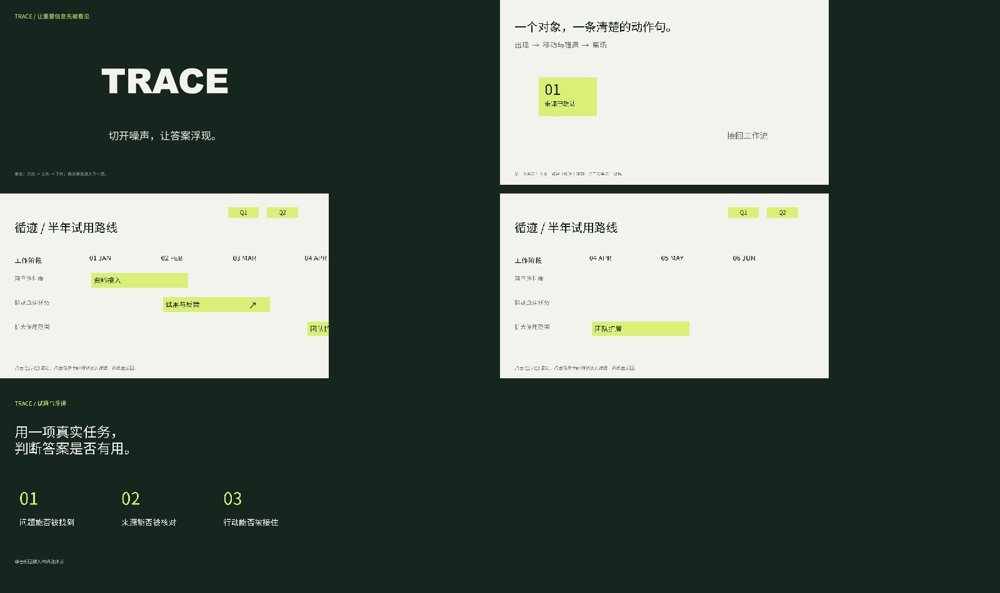

# 可编辑动效组合

用同一套TRACE视觉语言展示三组制作方法。它补充[9页完整产品演示](../trace-product/trace-product.pptx)，不将技术小样当作完整商业叙事。

[打开PPTX](motion-combinations.pptx)



|页面|表达与操作|复用的原有机制|
|---|---|---|
|1|单击后刀光扫过，斜切标题上片、下片依次错位|`glyph_slices_*`的原生Subtract/Intersect操作方式、既有路径与COM Timing|
|2|同一个组入场，移动时同步缩放/轻转，再次单击离场|原生组合、MainSequence追加效果、`wheel_focus_*`缩放与`polish_timing.ps1`的时序方法|
|3–4|季度按钮前滚/后滚，标题与行标签固定，任务在遮罩下连续移动|`build_components.Deck`复制/命名、Morph、内部SlideID导航、已有遮罩层级方法|
|5|点击Q1任务中的↗进入，单击返回，再次进入|透明cover的真正Slide Zoom/Return to Zoom；普通原生箭头负责可见的连续运动|

切片后上下片为可编辑矢量轮廓；原始标题作为隐藏文字保留在第1页。普通文字、任务、网格、组合与导航均可继续编辑。文字变化后需重建切片，不能直接把轮廓当文本改字。

制作使用OfficeCLI基础页面与原生COM精修；只在本示例目录保留两份制作源，没有新增引擎或修改原配方。需要Windows桌面版PowerPoint、OfficeCLI及Python。正文使用Noto Sans SC，切片使用Arial Black；跨机替换字体后检查布局。

```powershell
python examples/motion-combinations/build.py --officecli OFFICECLI --out NEW/base.pptx --text TRACE
powershell -NoProfile -ExecutionPolicy Bypass -File examples/motion-combinations/finish.ps1 -InputDeck NEW/base.pptx -OutputDeck NEW/final.pptx -PreviewDirectory NEW/native
```

每次使用新输出路径。精修可调`Angle`、`Duration`、`TopDelay`、`BottomDelay`、`TopDistanceCm`、`BottomDistanceCm`、`SeparationCm`；切线、刀光和片段位移按同一角度计算。交付样稿只验证默认TRACE/Arial Black单行参数，新文字、切线、字体或多行须重新预览。

组合中发现的缩略图/Morph冲突在制作时修复：用随任务移动的普通箭头保持视觉连续，透明自定义cover保留真实Zoom交互，遮罩仍覆盖移出窗口的入口。显示缩放造成的测试点击偏差单独修正，没有更改导航关系来迎合测试。

最终样稿使用本机PowerPoint完成51秒原生放映与12次物理操作，覆盖刀光/两片先后、同组五个效果、Q1→Q2→Q1、详情进入/返回两轮及最后再滚到Q2；复看22个分布帧和Morph中间态。另存重开后两处Zoom仍为透明custom cover。OfficeCLI文件验证通过。[最终原生播放记录](playback.mp4)随作品保留。

原生播放结果以本目录最终样稿为准。完整书本翻页、PA插件专属形转路径/时间序列界面与任意速度连击不属于此样稿的通过范围；3D场景继续复用已有铰链和双面GLB配方。
