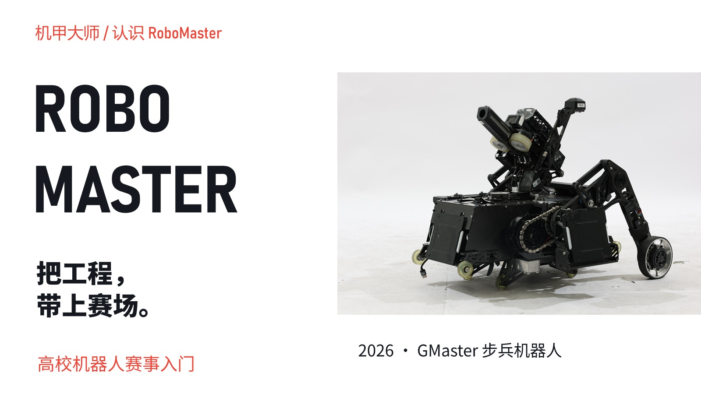

# RoboMaster：把工程，带上赛场

[可编辑PPTX](robomaster.pptx) · [十一页预览](preview.jpg) · [原生实播](playback.mp4)

面向首次接触RoboMaster的观众，介绍高校机器人赛事、观赛目标、兵种、工程链路与团队协作。白底、黑字、竞速红构成整套视觉语言；两页图鉴分别采用英雄、工程、步兵、哨兵，以及空中机器人、雷达、飞镖的对应实物照片。工程页使用哨兵照片，协作页使用团队与整套机器人合影，避免一张图片反复填充。正文、标签、关系线与页面结构保留可编辑性，页面不添加声明性小字。

## 内容与来源

- [官方高校系列赛介绍](https://www.robomaster.com/zh-CN/robo/overview)：赛事定位、DJI发起、跨学科实践与青年工程师文化。
- [官方RMUC介绍](https://www.robomaster.com/zh-CN/robo/rm)：2027赛季规则概述与观赛目标。
- [RMUC 2027 规则文件](https://bbs.robomaster.com/wiki/20204847/1969149)：中文V1.0.0，2026-10-15发布。印刷页13、20–28核对重装、步兵、哨兵及组合系统；印刷页29–30的图4-1、图4-3用于赛场视图。资料于2026-11-07核验。

2026实物图鉴和2027规则演进分别讲解：前者展示GMaster公开车型，后者说明英雄与工程合并为重装，不用旧车型冒充新赛季重装实物。工程链路、协作关系与常见团队分工是教学概括，示意连线不代表真实对局路线。各张照片的年份、车型及来源保留在页面身份信息和备注中。

## 素材与重建

素材来自GMaster、BirdieBot战队的公开图库，以及RoboMaster官网与规则手册，版权归原权利人；本项目不声明素材为原创或开放许可。`assets/images.json`记录尺寸与规则手册图片页码，原图链接见[素材来源](assets/SOURCES.md)。文字事实与素材来源也保存在PPT备注中。

`rebuild.ps1`调用已有PPT Adapt机制，从本地素材重建PPTX及预览；Agent负责本机OfficeCLI和Python路径。重建使用新的输出目录，不覆盖交付文件，不下载素材。字体使用Noto Sans SC、Noto Sans SC Black和Bahnschrift SemiCondensed；换机应保留字体或替换后预览折行。

交付完成十一页原生预览与52秒PowerPoint连续实播，10次真实前进键覆盖全稿，未发现文字框溢出。相同英雄与工程照片在图鉴和规则演进之间使用Morph，其他不同主体使用淡化切换；复看图鉴对应关系、雷达方向和转场中间状态。[播放记录](native-playback.json)绑定当前PPTX和视频，结论限于这份作品及本次路线。
